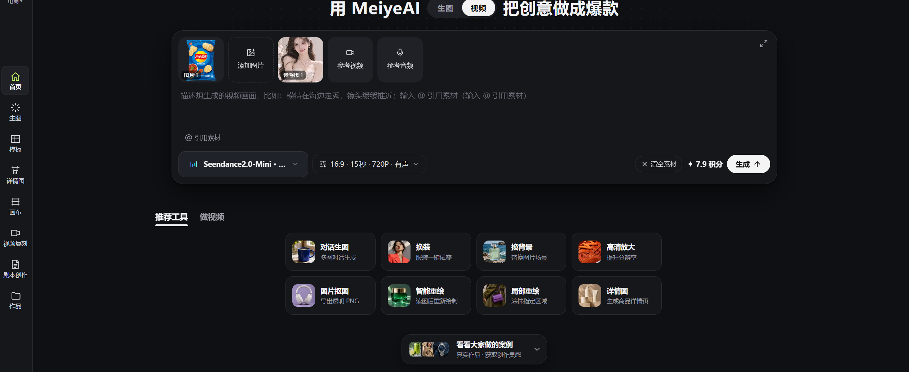
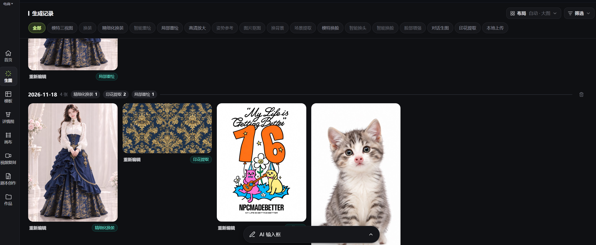
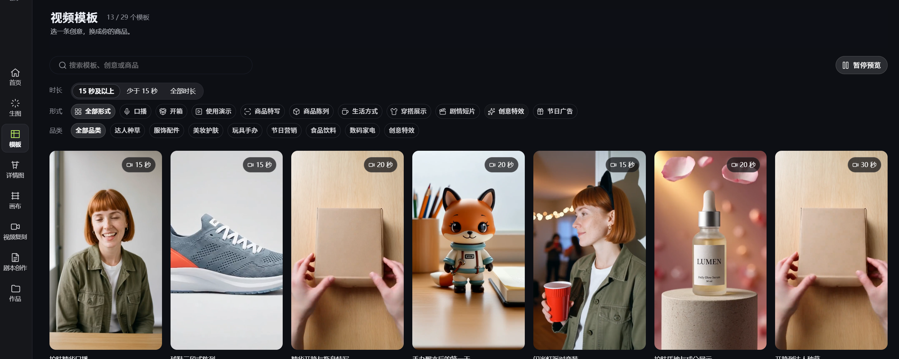
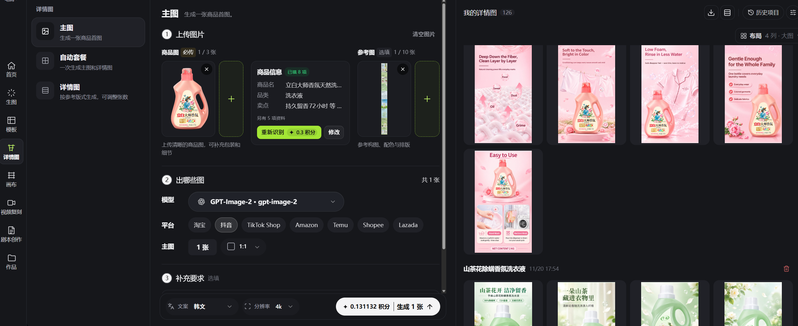
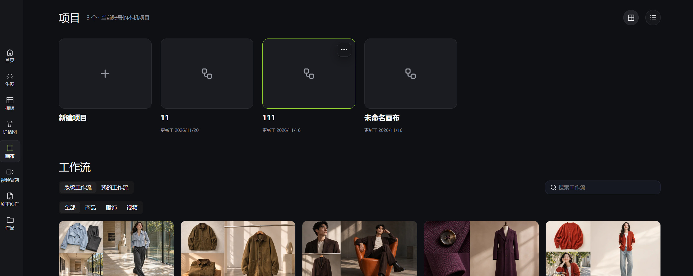
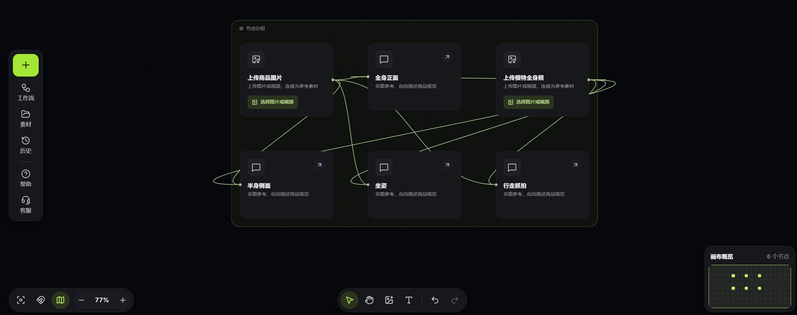

<h1 align="center">Lazy Sheep - E-commerce Agent</h1>
<p align="center">
  <a href="https://meiyeai.cn/">在线体验</a>
  · <a href="https://github.com/WMRBYY/Lazy-Sheep-E-commerce-Agent/releases/tag/9.0">9.0 版本说明</a>
  · <a href="#功能预览">功能预览</a>
  · <a href="#快速开始">快速开始</a>
  · <a href="#许可与署名">许可与署名</a>
</p>

这是一个可自部署的电商工作台。可以做商品图、换装、主图和详情图，也可以在画布里把同一组素材接到多个出图步骤上。由 **meiyeai** 维护，基于 Open AI Canvas 开发。

## 功能预览

以下截图来自在线体验站。自部署后的模板和作品取决于你配置的素材及生成记录。

### 首页

在首页切换生图或视频。做视频时可以在同一个输入框里添加商品图、参考视频和音频，再选比例、时长和分辨率。



### 生图

换装、印花提取和局部重绘的结果都在生成记录里。按功能筛一遍，找到要接着改的图，点「重新编辑」。也可以打开单张图片，在对照台里比较几个版本。



### 视频模板

想找一条开箱视频，或者看看商品特写怎么拍，可以按时长、形式和品类筛选，再在列表里预览。自部署时使用自己有权使用的模板素材。



### 主图与详情图

上传商品图后，可以补一张参考图来定构图和排版。主图、详情图可以分开做，也可以从「自动套餐」一起出。右侧保留生成结果，方便回看同一款商品的不同版本。



### 电商画布

从项目页新建画布，或选一个工作流开始。图中的换装工作流把商品图和模特全身照接到四个出图节点，分别做全身正面、半身侧面、坐姿和行走抓拍。





### 作品库

做完一组图，可以在作品页按日期找到整批结果。页内可切换图片和视频、只看收藏，也可以批量选中。


### 自部署管理

仓库提供用户管理、积分与通用支付能力。普通图片与视频生成使用部署者配置的模型服务，支付由部署者配置自己的商户渠道。

## 公开边界

灵犀中枢、视频复刻、剧本创作及电商视频 Agent 的前端实现、后端流程、数据模型、迁移和业务数据均为私有。开源版侧栏仅保留视频复刻和剧本创作的禁用图标。

指定移除的后台管理功能不提供管理页面或接口。保留功能所需的通用运行组件仍可存在，例如支付适配器、通用任务队列和画布助手运行组件。[完整范围](docs/PUBLIC_SCOPE.md)

不提供原站数据库、用户账号、支付配置、API 密钥、中转地址、预置私有知识库、上传素材或运维记录。请使用全新数据库和存储目录。

## 快速开始

```sh
git clone https://github.com/WMRBYY/Lazy-Sheep-E-commerce-Agent.git
cd Lazy-Sheep-E-commerce-Agent
```

可使用 Docker Compose 启动整套服务，或在本机分别运行前后端。

### 本地开发

需要 Go 1.25 或兼容版本、C 编译器、Node.js 与 Bun 1.3.9。SQLite 驱动使用 CGO。

在仓库根目录运行以下命令，从源码生成本地测试用的文字、图片和视频请求协议包。Docker 构建会自行打包协议与支付适配器。

```sh
sh plugin-packages/build-packages.sh --protocol openai-chat-completions
sh plugin-packages/build-packages.sh --protocol openai-images
sh plugin-packages/build-packages.sh --protocol openai-videos
```

PowerShell 可使用 `& .\plugin-packages\package-selected.ps1 openai-chat-completions openai-images openai-videos` 做同样的准备。依赖其他模型协议时，按部署者需求打包相应协议。

```sh
cd backend/agent-runtime/pi
npm ci
cd ../..
CANVAS_BACKEND_DATA_DIR=../.local/development go run ./cmd/server
```

另开终端运行前端：

```sh
cd web
bun install --frozen-lockfile
bun run dev
```

访问 `http://localhost:3000`，首次安装时注册管理员，然后配置自己的模型渠道。模型密钥和支付商户配置不写入源码或提交记录。前端开发代理默认指向 `http://127.0.0.1:8080`。

PowerShell 用户在运行后端前使用 `$env:CANVAS_BACKEND_DATA_DIR='../.local/development'` 设置数据目录。

### Docker Compose

复制 `.env.example` 为 `.env`，为 `POSTGRES_PASSWORD` 和 `YINGCE_AGENT_TOKEN` 分别生成独立的随机值。推荐使用至少 32 字符的随机十六进制字符串，避免数据库连接字符串转义问题。按实际部署地址设置 `CANVAS_CORS_ORIGINS` 和 `CANVAS_PUBLIC_BASE_URL`。

```sh
docker compose up -d --build
docker compose ps
```

默认访问 `http://localhost:3000`。数据库、Redis、资源文件和前端静态文件分别保存在命名卷中。首次管理员注册应在受控网络完成；公开服务应配置 HTTPS，默认关闭后续公开注册。

Compose 使用当前仓库源码构建，不会拉取原站的私有业务配置。升级前备份部署者自己的数据卷。

## 检查与限制

```sh
cd web
bun run typecheck
bun run build
cd ../backend
go test ./...
```

真实模型生成和支付交易需要部署者配置并自行验收。编译、测试或模拟调用通过不代表所有供应商兼容性、生成质量和商户交易均已验证。

第三方组件、模型标识与公共分类数据遵循各自许可证；相关声明随对应目录保留。开源许可仅适用于本仓库实际发布的文件，不涉及未发布的私有模块或资料。

## 许可与署名

本项目采用 [MIT](https://github.com/ddcat-ai/open-ai-canvas/blob/main/LICENSE) 协议。项目特定代码的版权归 Lazy Sheep - E-commerce Agent 所有；第三方组件按各自附带的许可证和版权声明使用。

[本仓库许可证](LICENSE) · [版权与来源](NOTICE) · [第三方许可](docs/THIRD_PARTY_LICENSES.md)
