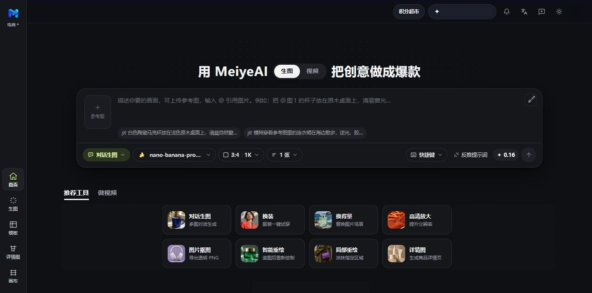
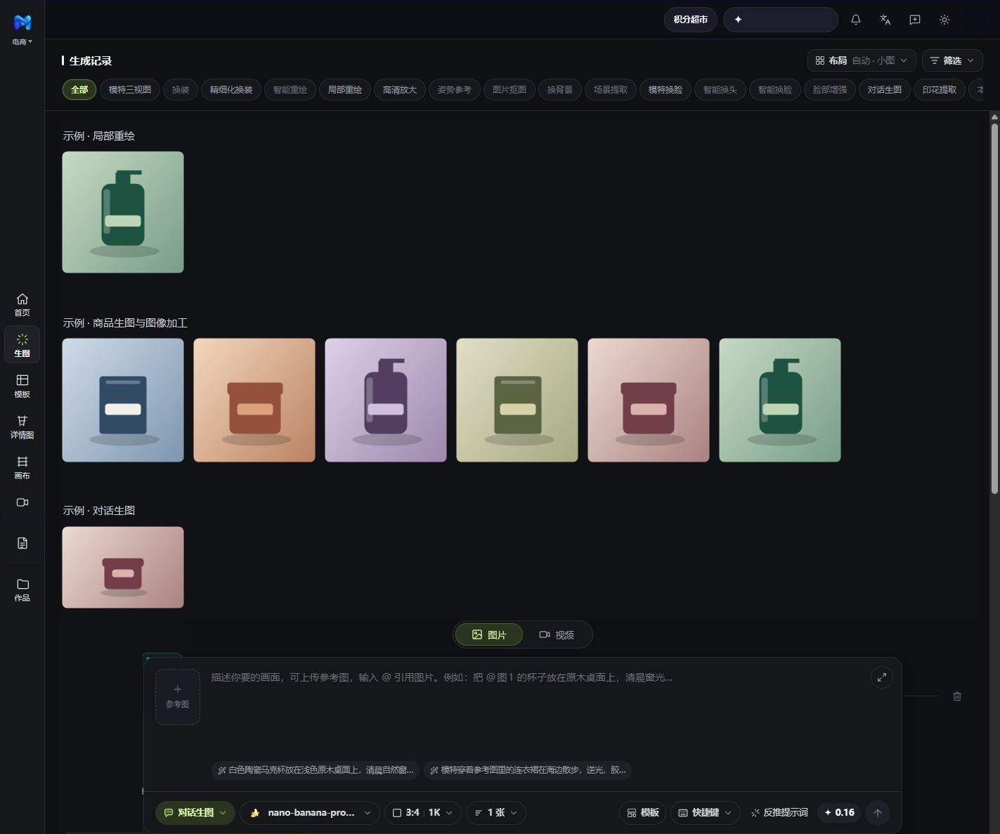
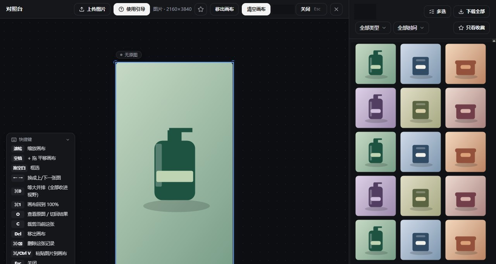
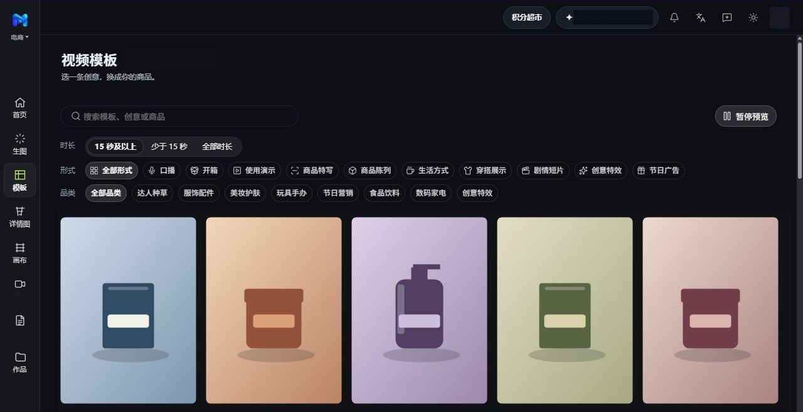
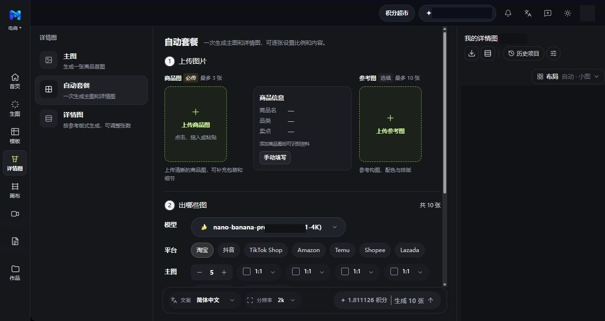
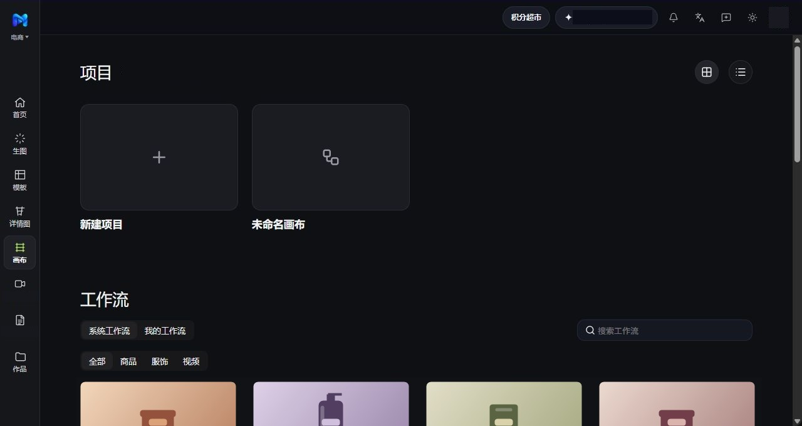
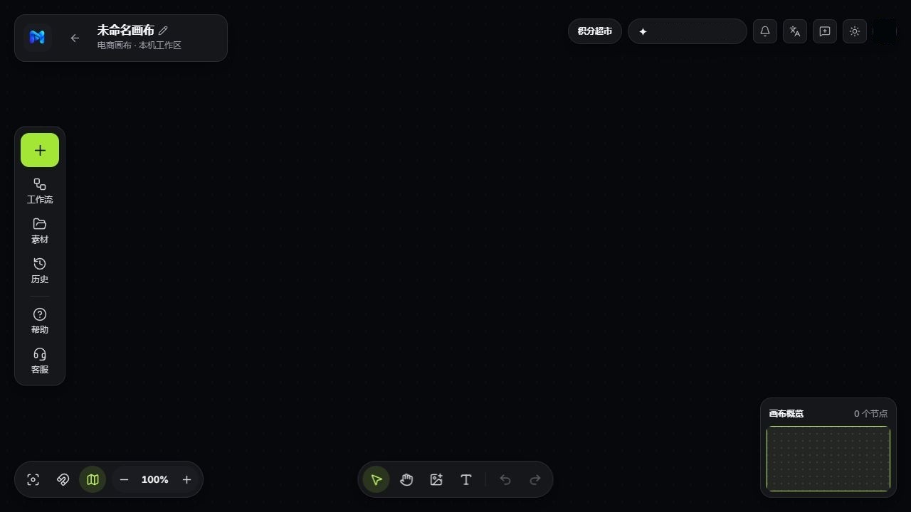
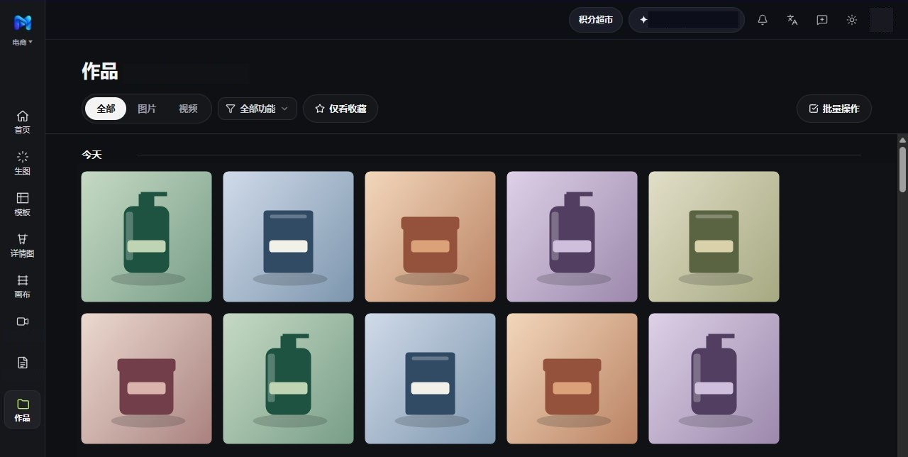

<h1 align="center">MeiYeAI 电商创作工作台</h1>
<p align="center">为商品素材制作、视觉对照与工作流编排而建的开源工作台</p>
<p align="center">
  <a href="https://github.com/WMRBYY/meiyeai-ecommerce/releases/tag/9.0">9.0 版本说明</a>
  · <a href="#功能预览">功能预览</a>
  · <a href="#快速开始">快速开始</a>
  · <a href="#许可与署名">许可与署名</a>
</p>

在同一个工作台里完成商品生图、批量换装、主图与详情图制作。用对照台比较生成结果，用电商画布编排素材与工作流，在作品库按类型找回阶段产出。项目由 **meiyeai** 维护，基于 Open AI Canvas 开发，支持自部署。



## 功能预览

> 界面取自 MeiYeAI 电商工作台实拍。发布图已遮挡账号信息，涉及原站素材的位置使用演示图。自部署后的图库由自己的创作记录填充，模板库由部署者提供有权使用的目录与媒体。

### 首页与生图

首页汇集常用创作入口，可以从一句描述或参考图开始。生图工作台将生成参数与历史记录放在同一页，支持对话生图、批量换装和图像加工，可以按功能筛选结果，并重新编辑已有记录。



### 对照台

从生成记录或作品库打开图片，在一张工作台上放置多个版本。可并排排列、缩放查看细节，按需查看原图或继续裁剪、重绘和放大。



### 模板与详情图

| 视频模板 | 商品主图与详情图 |
| --- | --- |
|  |  |
| 按时长、形式和商品品类筛选，在卡片内预览构图与节奏。模板媒体由部署者配置。 | 用商品图确定主体，用参考图约束版式。可分别制作主图和详情图，也可通过自动套餐统一设置平台、尺寸与张数。 |

### 电商画布

项目页集中管理本机画布和工作流入口。在编辑器内通过节点和连线组织素材、提示词与生成步骤，适合把多步骤商品创作方案整理成可复用的流程。





### 作品库

图片与视频按日期归档，支持按媒体类型、功能和收藏状态筛选。可批量管理产出，也可点开图片回到对照台继续处理。



### 自部署管理

仓库提供用户管理、积分与通用支付能力。普通图片与视频生成使用部署者配置的模型服务，支付由部署者配置自己的商户渠道。

## 公开边界

视频复刻、剧本创作及电商视频 Agent 的前端、后端、数据模型、迁移和数据均不包含在本仓库中。对应前端入口仅作为禁用图标展示。

指定移除的后台管理功能不提供管理页面或接口。保留功能所需的通用运行组件仍可存在，例如支付适配器、通用任务队列和画布助手运行组件。[完整范围](docs/PUBLIC_SCOPE.md)

不提供原站数据库、用户账号、支付配置、API 密钥、中转地址、预置私有知识库、上传素材或运维记录。请使用全新数据库和存储目录。

## 快速开始

```sh
git clone https://github.com/WMRBYY/meiyeai-ecommerce.git
cd meiyeai-ecommerce
```

可使用 Docker Compose 启动整套服务，或在本机分别运行前后端。

### 本地开发

需要 Go 1.25 或兼容版本、C 编译器、Node.js 与 Bun 1.3.9。SQLite 驱动使用 CGO。

在仓库根目录运行以下命令，从源码生成本地测试用的文字、图片和视频请求协议包。Docker 构建会自行打包协议与支付适配器。

```sh
sh plugin-packages/build-packages.sh --protocol openai-chat-completions
sh plugin-packages/build-packages.sh --protocol openai-images
sh plugin-packages/build-packages.sh --protocol openai-videos
```

PowerShell 可使用 `& .\plugin-packages\package-selected.ps1 openai-chat-completions openai-images openai-videos` 做同样的准备。依赖其他模型协议时，按部署者需求打包相应协议。

```sh
cd backend/agent-runtime/pi
npm ci
cd ../..
CANVAS_BACKEND_DATA_DIR=../.local/development go run ./cmd/server
```

另开终端运行前端：

```sh
cd web
bun install --frozen-lockfile
bun run dev
```

访问 `http://localhost:3000`，首次安装时注册管理员，然后配置自己的模型渠道。模型密钥和支付商户配置不写入源码或提交记录。前端开发代理默认指向 `http://127.0.0.1:8080`。

PowerShell 用户在运行后端前使用 `$env:CANVAS_BACKEND_DATA_DIR='../.local/development'` 设置数据目录。

### Docker Compose

复制 `.env.example` 为 `.env`，为 `POSTGRES_PASSWORD` 和 `YINGCE_AGENT_TOKEN` 分别生成独立的随机值。推荐使用至少 32 字符的随机十六进制字符串，避免数据库连接字符串转义问题。按实际部署地址设置 `CANVAS_CORS_ORIGINS` 和 `CANVAS_PUBLIC_BASE_URL`。

```sh
docker compose up -d --build
docker compose ps
```

默认访问 `http://localhost:3000`。数据库、Redis、资源文件和前端静态文件分别保存在命名卷中。首次管理员注册应在受控网络完成；公开服务应配置 HTTPS，默认关闭后续公开注册。

Compose 使用当前仓库源码构建，不会拉取原站的私有业务配置。升级前备份部署者自己的数据卷。

## 检查与限制

```sh
cd web
bun run typecheck
bun run build
cd ../backend
go test ./...
```

真实模型生成和支付交易需要部署者配置并自行验收。编译、测试或模拟调用通过不代表所有供应商兼容性、生成质量和商户交易均已验证。

第三方组件、模型标识与公共分类数据遵循各自许可证；相关声明随对应目录保留。开源许可仅适用于本仓库实际发布的文件，不涉及未发布的私有模块或资料。

## 许可与署名

MeiYeAI 电商创作工作台由 **meiyeai** 维护。本仓库的 MIT 许可允许二次开发和商业使用。复制或分发软件及其主要部分时，须保留 meiyeai 与适用的上游版权及许可声明。[MIT 许可证](LICENSE) · [版权与来源](NOTICE)

第三方组件遵循各自许可证。生产部署涉及 tldraw 绘图组件时需使用有效许可，FFmpeg 内核另有 GPL 条件。[第三方许可](docs/THIRD_PARTY_LICENSES.md)
